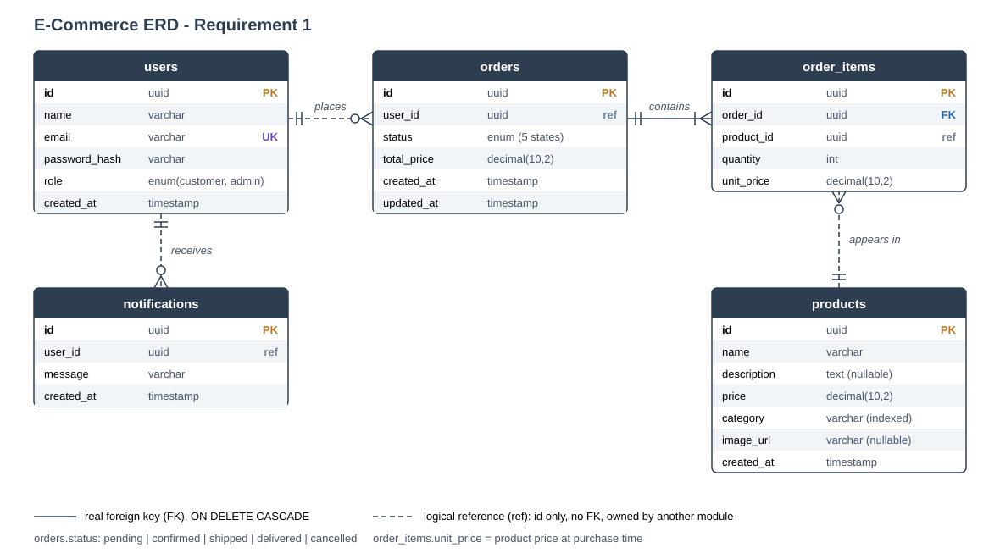
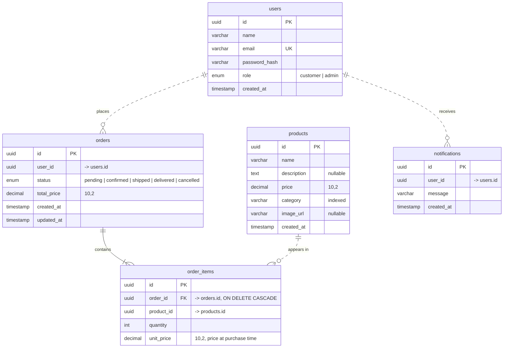

# ERD - المتطلب الأول

## ملاحظات

- الخط المتصل بين orders و order_items هو foreign key حقيقي لأن الجدولين بنفس الوحدة، وإذا انحذف الطلب بتنحذف عناصره (cascade).
- الخطوط المنقطة ما فيها foreign key، بس منخزن الـ id. كل وحدة بتتعامل مع جداولها بس، ووحدة الطلبات بتجيب المنتج من ProductsService.
- unit_price هو سعر المنتج وقت الطلب، مشان ما يتغير الطلب القديم إذا تغير السعر.
